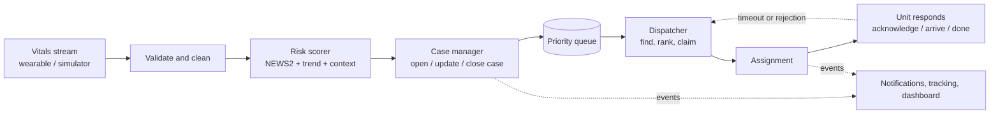
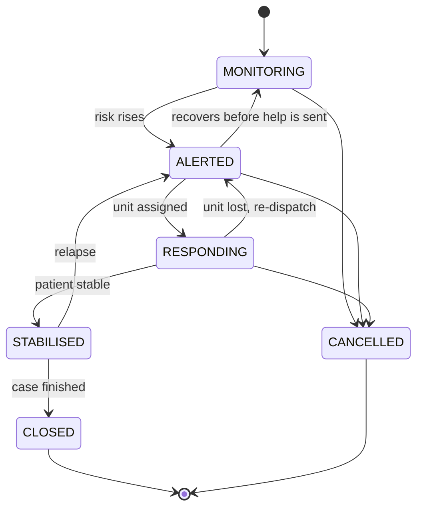
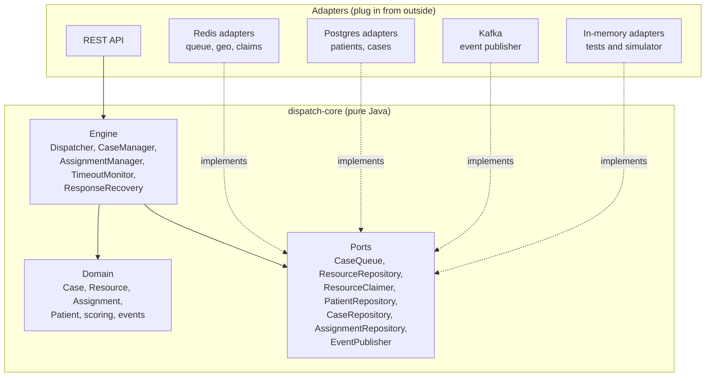

# MediDispatch

**Vitals-driven emergency response.** MediDispatch watches a patient's live vital signs, turns them into a continuously updated risk score, and dispatches the right help (a nurse call, a medicine delivery, a basic or advanced ambulance) to the people who need it most, in priority order.

> **Simulation only.** MediDispatch is a learning and research prototype. It runs on **synthetic patients and synthetic vitals**. It is **not a medical device** and must never be used for real clinical or emergency decisions.

---

## Table of contents

- [The problem](#the-problem)
- [The idea](#the-idea)
- [How it works](#how-it-works)
- [What makes it different](#what-makes-it-different)
- [Architecture](#architecture)
- [Tech stack](#tech-stack)
- [Design principles](#design-principles)
- [Project status](#project-status)
- [Roadmap](#roadmap)
- [Getting started](#getting-started)
- [Repository layout](#repository-layout)
- [Testing](#testing)
- [Safety, privacy and fairness](#safety-privacy-and-fairness)

---

## The problem

Emergency dispatch is usually **reactive and call-driven**: someone notices a problem, phones for help, and a dispatcher decides who goes first based on what the caller says. Two weaknesses follow:

1. **Deterioration is noticed late.** For people at risk (the elderly, cardiac and respiratory patients, people with chronic conditions), the signs often show in their vitals hours or minutes before anyone calls.
2. **Priority is subjective.** Who gets the one available ambulance depends on how an emergency is described, not on a consistent, explainable measure of how sick each person actually is.

## The idea

Monitor registered, at-risk people continuously and let **their own vitals decide the priority**.

- Vitals stream in from wearables (simulated in this project).
- Each patient gets a **risk score**, recalculated whenever new data arrives, using established early-warning methods rather than invented formulas.
- The score decides whether to do nothing, prompt the patient, call a nurse, send medicine, or send an ambulance.
- Cases wait in a **priority queue** that re-ranks itself as patients get better or worse.
- A **dispatch engine** matches the most urgent case to the nearest suitable unit, claims it safely so it can never be sent twice, and reacts when things go wrong (a unit that doesn't respond, a worse case appearing).

The headline metric is **time from deterioration to dispatch**.

## How it works



**The life of a patient's case**



**Escalation ladder** (which response a risk band triggers):

| Risk band | Typical response |
|---|---|
| LOW | Keep monitoring |
| MEDIUM | Prompt the patient / nurse tele-call |
| HIGH | Basic or advanced life-support ambulance |
| CRITICAL | Advanced life-support ambulance, highest priority, may preempt lower-priority responses |

Medicine delivery is a response type for patients who need an urgent medicine rather than emergency care.

## What makes it different

- **Priority comes from live vitals, not a label.** A patient's rank in the queue changes as their numbers change.
- **Standards-based scoring.** The scorer is built around published early-warning scores (NEWS2 first), then extended with trend, a personal baseline and context such as age and conditions. Every score is **explainable**: it records which vitals contributed.
- **A framework-free core.** The decision logic is plain Java with no framework dependency, so it can be tested in milliseconds and run unchanged inside a simulator, a REST service or a Kubernetes deployment.
- **Safe by construction.** Illegal states cannot be built: invalid readings are rejected, cases and units follow strict state machines, and a unit can only be claimed by one case at a time, even under heavy concurrency.
- **Failure-aware.** Timeouts, reassignment and preemption are part of the design, not afterthoughts.
- **Measurable.** A built-in simulator generates thousands of patients with realistic trajectories so scoring strategies can be compared on detection and response times.

## Architecture

MediDispatch uses **ports and adapters** (hexagonal architecture). The core contains all the logic and depends only on interfaces it defines itself; infrastructure plugs in from the outside.



**Planned service layout**

| Service | Responsibility |
|---|---|
| `dispatch-core` | The engine: domain model, scoring, dispatch logic, ports, in-memory adapters |
| `dispatch-service` | Spring Boot wrapper: REST API, Redis and Postgres adapters, wiring |
| `ingestion-service` | High-volume vitals intake, validation and cleaning |
| `fleet-service` | Ambulances, nurses and couriers, their status and live location |
| `hospital-service` | Capacity and departments, destination selection after pickup |
| `tracking-service` | Live positions and ETAs over websockets |
| `notification-service` | Alerts to dispatchers, patients, caregivers and responders |
| `simulator` | Synthetic patients and moving units for demos and load tests |
| `dashboard` | Live patient board and map |

The earlier Spring Cloud work (API gateway, service discovery, central config) is reused for the platform layer.

## Tech stack

| Area | Technology |
|---|---|
| Language | Java 21 |
| Build | Maven (multi-module) |
| Core | Plain Java, no framework |
| Services | Spring Boot, Spring Cloud |
| Storage | PostgreSQL (Flyway migrations), Redis (geo index, sorted sets, atomic claims) |
| Messaging | Apache Kafka (event streaming, outbox pattern) |
| Resilience and observability | Resilience4j, OpenTelemetry, Zipkin, Prometheus, Grafana |
| Containers | Docker, Docker Compose, Kubernetes (with autoscaling) |
| Testing | JUnit 5, Testcontainers, k6 or Gatling |

## Design principles

- **Illegal states are unrepresentable.** Constructors validate; state machines guard every transition.
- **Immutability where possible.** Records for values, defensive copies for collections.
- **Depend on interfaces.** The engine imports ports, never infrastructure.
- **Inject time.** A `Clock` is passed in, so timeouts and timestamps are testable without waiting.
- **Atomic where it matters.** Claiming a unit is a single atomic step, never check-then-act.
- **Never lose work.** Every failure path puts the case back in the queue.
- **Explainable decisions.** Scores, assignments and events carry the reasons behind them.

## Project status

Early development. The pure-Java core is being built bottom-up, each piece with tests.

**Built and tested**

| Area | Components |
|---|---|
| Vitals and scoring | `VitalsReading` (validated), `RiskBand`, `RiskAssessment`, `RiskScorer`, a placeholder `SimpleScorer` |
| Cases | `Case` and `CaseStatus` state machine |
| Resources | `Resource`, `ResourceStatus` state machine, `ResourceType`, `Location` (haversine distance) |
| Assignments | `Assignment` entity and `AssignmentStatus` state machine (`ASSIGNED`, `EN_ROUTE`, `ARRIVED`, `DONE`, `CANCELLED`, `TIMED_OUT`, `FAILED`), so the record says why a trip ended |
| People | `Patient` |
| Ports and in-memory adapters | `CaseQueue`, `ResourceRepository`, `ResourceClaimer` (with a concurrency test), `PatientRepository`, `CaseRepository`, `AssignmentRepository`, `EventPublisher` |
| Events | `CaseStatusChanged`, `CaseBandChanged`, `UnitAssigned`, `AssignmentStatusChanged` (immutable records, published after the state is saved, silent when nothing changed) |
| Engine | `Dispatcher` (priority-ordered, nearest suitable unit, safe claiming with fallback), `CaseManager` (turns risk assessments into alerted, queued and re-ranked cases, and tracks the case to closure), `AssignmentManager` (trip progress, and returning the unit and its claim to the pool when a trip ends; a unit whose trip timed out or failed is taken offline instead), `TimeoutMonitor` (gives up on a unit that never acknowledges its assignment), `ResponseRecovery` (one entry point for "this unit is lost": the trip ends and the case goes back to the queue so the next-best unit is sent) |

The full lifecycle works in memory and is covered by a test: a severely abnormal reading is scored, becomes an alerted case, is dispatched to the nearest suitable ambulance, travels, arrives, and is closed. The ambulance is then freed and serves the next waiting patient, and the engine announces every step as an ordered list of events.

Failure recovery works in memory: if the nearest ambulance never acknowledges its assignment, the monitor times the trip out, the unit goes offline (so it is never picked again), the case returns to the queue, and the next-best ambulance is sent.

An explicit failure report (`onFailed`, for breakdowns and "cannot complete") follows the same path: the trip ends as `FAILED`, the unit goes offline, and the case is requeued and reassigned.

**In progress:** live monitoring of units that are en route: a unit that stops moving or loses signal is declared lost and replaced. After that: preemption.

`SimpleScorer` is a deliberate **placeholder, not clinical**; it exists so the rest of the engine can be built and tested. It will be replaced by a NEWS2-based scorer.

## Roadmap

**Core engine (pure Java)**
- [x] Vitals model with validation
- [x] Risk assessment model and scorer interface
- [x] Case and resource state machines
- [x] Ports and in-memory adapters (queue, resources, claims, patients)
- [x] Dispatcher with atomic claiming
- [x] Case repository and case manager
- [x] Assignment as an entity with a lifecycle
- [x] Resource release and case completion
- [x] Event publisher port and domain events
- [x] Timeouts and automatic reassignment
- [x] Explicit unit failure (`onFailed`): breakdown or "cannot complete" reroutes the case to another unit
- [ ] Live trip monitoring: a unit that stops moving or loses signal while en route is declared lost and replaced
- [ ] Preemption of lower-priority responses
- [ ] Response decider (escalation ladder)
- [ ] Single entry point for readings (`VitalsProcessor`)
- [ ] Patient and unit simulator, with scorer comparison results
- [ ] Real scoring: NEWS2, trend analysis, personal baseline, context, data-quality handling

**Application layer**
- [ ] Spring Boot service: REST API, Postgres and Redis adapters, authentication and roles
- [ ] Hospital selection and resilience (circuit breakers, retries)
- [ ] Kafka: event streaming, outbox pattern, idempotent consumers, ingestion service
- [ ] Tracking and notification services
- [ ] Docker, Docker Compose, Kubernetes with autoscaling
- [ ] Observability: metrics, tracing, dashboards
- [ ] Load testing and bottleneck analysis
- [ ] Live dashboard and demo

The full plan is in [PLAN.md](PLAN.md).

## Getting started

**Requirements:** JDK 21 and Maven (or an IDE with Maven support, such as IntelliJ IDEA).

```bash
git clone <this-repository>
cd medidispatch
mvn test
```

The engine is a library, so there is no server to start yet. The easiest way to see it work is to read a test: `FullLifecycleTest` wires the whole engine to in-memory adapters and plays out two emergencies that share one ambulance, ending with the ordered list of events the engine announced. `DispatcherTest` covers the dispatch rules in detail.

A minimal example of the engine wired by hand:

```java
CaseQueue queue = new InMemoryCaseQueue();
PatientRepository patients = new InMemoryPatientRepository();
ResourceRepository resources = new InMemoryResourceRepository();
ResourceClaimer claimer = new InMemoryResourceClaimer();
AssignmentRepository assignments = new InMemoryAssignmentRepository();
EventPublisher publisher = new InMemoryEventPublisher();

Dispatcher dispatcher = new Dispatcher(queue, patients, resources, claimer,
        assignments, publisher, Clock.systemUTC(), 20.0);   // search radius in km

Optional<Assignment> assignment = dispatcher.dispatchNext();
```

## Repository layout

```
medidispatch/
  pom.xml                     parent build
  PLAN.md                     detailed project plan
  dispatch-core/              pure-Java engine
    src/main/java/com/medidispatch/core/
      domain/                 Case, Resource, Assignment, Patient, Location, VitalsReading, RiskAssessment, ...
      scoring/                RiskScorer and its implementations
      engine/                 Dispatcher, CaseManager, AssignmentManager, TimeoutMonitor, ResponseRecovery (more to come)
      event/                  domain events the engine announces
      port/                   interfaces the core needs from the outside world
      memory/                 in-memory adapters for tests and the simulator
    src/test/java/...         unit, concurrency and scenario tests
  (planned)
  dispatch-service/  ingestion-service/  fleet-service/  hospital-service/
  tracking-service/  notification-service/  simulator/  dashboard/  deploy/  docs/
```

## Testing

Every component is covered by tests, including:

- exhaustive state-machine tables (every legal and illegal transition),
- boundary and edge cases for validation and scoring,
- a **concurrency test**: 100 threads race to claim one ambulance, and exactly one wins,
- scenario tests for the dispatcher (priority ordering, wrong unit types, units out of range, fallback when a unit is already claimed, retry when none is available),
- a full-lifecycle test that runs a reading all the way to a closed case and a reused ambulance, and asserts the exact ordered list of events,
- "nothing happens" tests: repeating an assessment, or attempting an illegal move, changes no state and publishes no events,
- time-based tests driven by a controllable clock, so "the unit stayed silent for 60 seconds" runs instantly, including the recovery scenario where the nearest ambulance goes silent and the next one is sent.

Planned: contract tests that run the same suite against the in-memory and the Redis adapters, Testcontainers integration tests, and simulator-driven load tests.

## Safety, privacy and fairness

- **Not for clinical use.** Synthetic data only. Scores and decisions here have no medical validity.
- **Established methods, not invented medicine.** Scoring is built on published early-warning scores, cited in the scoring specification.
- **Privacy by design.** Even with synthetic data, the system is designed as if it handled real health data: role-based access, audit logging of every patient-record access, and encryption in transit and at rest.
- **Fairness.** Age and conditions are meant to raise appropriate attention, never silently lower it. This is covered by dedicated scenario tests.
- **Safe degradation.** If scoring is unavailable, the system falls back to the last known risk plus a conservative default. It never goes silent.
- **Alert fatigue.** Hysteresis and cooldowns prevent a patient on a band boundary from flooding responders with alerts.
