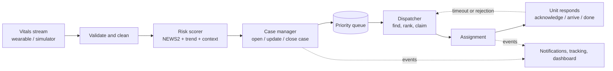
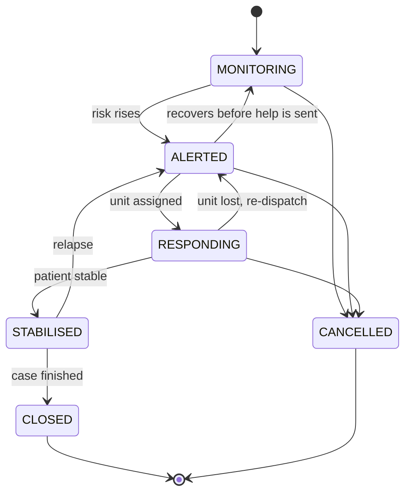
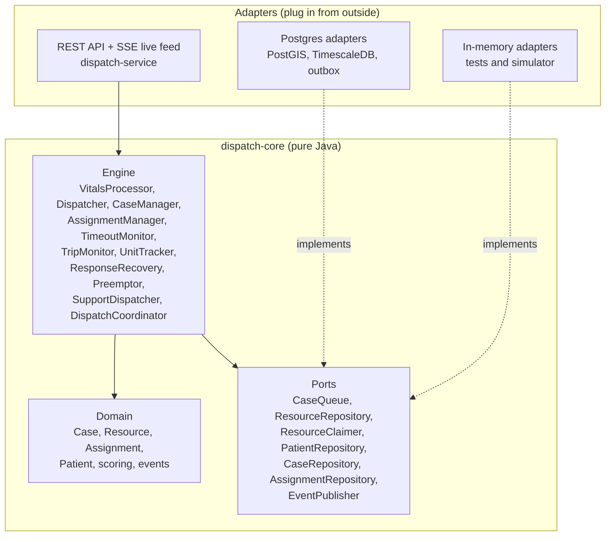

# MediDispatch

**Vitals-driven emergency response.** MediDispatch watches a patient's live vital signs, turns them into a continuously updated risk score, and dispatches the right help (a nurse call, a medicine delivery, a basic or advanced ambulance) to the people who need it most, in priority order.

> **Simulation only.** MediDispatch is a learning and research prototype. It runs on **synthetic patients and synthetic vitals**. It is **not a medical device** and must never be used for real clinical or emergency decisions.

---

## Table of contents

- [The problem](#the-problem)
- [The idea](#the-idea)
- [How it works](#how-it-works)
- [What makes it different](#what-makes-it-different)
- [Architecture](#architecture)
- [Tech stack](#tech-stack)
- [Design principles](#design-principles)
- [Project status](#project-status)
- [Roadmap](#roadmap)
- [Getting started](#getting-started)
- [Repository layout](#repository-layout)
- [Testing](#testing)
- [Safety, privacy and fairness](#safety-privacy-and-fairness)

---

## The problem

Emergency dispatch is usually **reactive and call-driven**: someone notices a problem, phones for help, and a dispatcher decides who goes first based on what the caller says. Two weaknesses follow:

1. **Deterioration is noticed late.** For people at risk (the elderly, cardiac and respiratory patients, people with chronic conditions), the signs often show in their vitals hours or minutes before anyone calls.
2. **Priority is subjective.** Who gets the one available ambulance depends on how an emergency is described, not on a consistent, explainable measure of how sick each person actually is.

## The idea

Monitor registered, at-risk people continuously and let **their own vitals decide the priority**.

- Vitals stream in from wearables (simulated in this project).
- Each patient gets a **risk score**, recalculated whenever new data arrives, using established early-warning methods rather than invented formulas.
- The score decides whether to do nothing, prompt the patient, call a nurse, send medicine, or send an ambulance.
- Cases wait in a **priority queue** that re-ranks itself as patients get better or worse.
- A **dispatch engine** matches the most urgent case to the nearest suitable unit, claims it safely so it can never be sent twice, and reacts when things go wrong (a unit that doesn't respond, a worse case appearing).

The headline metric is **time from deterioration to dispatch**.

## How it works



**The life of a patient's case**



**Escalation ladder** (which response a risk band triggers):

| Risk band | Typical response |
|---|---|
| LOW | Keep monitoring |
| MEDIUM | Prompt the patient / nurse tele-call |
| HIGH | Basic or advanced life-support ambulance |
| CRITICAL | Advanced life-support ambulance, highest priority, may preempt lower-priority responses |

Medicine delivery is a response type for patients who need an urgent medicine rather than emergency care.

## What makes it different

- **Priority comes from live vitals, not a label.** A patient's rank in the queue changes as their numbers change.
- **Standards-based scoring.** The scorer is built around published early-warning scores (NEWS2 first), then extended with trend, a personal baseline and context such as age and conditions. Every score is **explainable**: it records which vitals contributed.
- **A framework-free core.** The decision logic is plain Java with no framework dependency, so it can be tested in milliseconds and run unchanged inside a simulator, a REST service or a Kubernetes deployment.
- **Safe by construction.** Illegal states cannot be built: invalid readings are rejected, cases and units follow strict state machines, and a unit can only be claimed by one case at a time, even under heavy concurrency.
- **Failure-aware.** Timeouts, reassignment and preemption are part of the design, not afterthoughts.
- **Measurable.** A built-in simulator generates thousands of patients with realistic trajectories so scoring strategies can be compared on detection and response times.

## Architecture

MediDispatch uses **ports and adapters** (hexagonal architecture). The core contains all the logic and depends only on interfaces it defines itself; infrastructure plugs in from the outside.



**A modular monolith.** The application is one Spring Boot service (`dispatch-service`) with one database, split into packages rather than separate services: one deploy, and real transactions across cases, trips and unit claims. It gets split into services only when there is a measured reason.

```
 patient phone, crew phone (PWA), control room and hospital (web)
            | HTTPS commands                ^ SSE live feed
            v                               |
 +-------------------- dispatch-service (Spring Boot) --------------------+
 | api          controllers, JSON records, error mapping, auth (OTP, JWT) |
 | service      DispatchService: the single front door, the dispatch loop |
 | live         server-sent events for live screens                       |
 | persistence  Postgres / PostGIS / TimescaleDB adapters for the ports   |
 | dispatch-core  the pure-Java engine, wired by EngineConfig             |
 +-----------------------------------+------------------------------------+
                                     v
              Postgres + PostGIS + TimescaleDB (one server)
```

| Module | Responsibility |
|---|---|
| `dispatch-core` | The engine: domain model, scoring, dispatch logic, ports, in-memory adapters |
| `dispatch-service` | Spring Boot application: wiring, `DispatchService`, REST API, live feed, database adapters |
| `dispatch-sim` | Synthetic patients and moving units: a planned two-hour run and an endless live city |
| `dispatch-sim-fx` | JavaFX window showing the live simulated city |
| web app (planned) | One React + TypeScript app with four faces: control room, crew, patient, hospital |

## Tech stack

| Area | Technology |
|---|---|
| Language | Java 21 |
| Build | Maven (multi-module) |
| Core | Plain Java, no framework |
| Service | Spring Boot 4.1 (Spring MVC, scheduling), one modular monolith |
| Storage | PostgreSQL with PostGIS (nearest unit) and TimescaleDB (vitals history), Flyway migrations |
| Live data | Server-sent events for live screens; an outbox table for events |
| Frontend (planned) | React + TypeScript (Vite), installable as a PWA; MapLibre + OpenStreetMap |
| Containers | Docker Compose |
| Testing | JUnit 5, Spring Boot test, Testcontainers, MockMvc |
| If time allows | Web Push, MQTT, Redis (only if measured), Kafka, Kubernetes, Prometheus and Grafana |

## Design principles

- **Illegal states are unrepresentable.** Constructors validate; state machines guard every transition.
- **Immutability where possible.** Records for values, defensive copies for collections.
- **Depend on interfaces.** The engine imports ports, never infrastructure.
- **Inject time.** A `Clock` is passed in, so timeouts and timestamps are testable without waiting.
- **Atomic where it matters.** Claiming a unit is a single atomic step, never check-then-act.
- **Never lose work.** Every failure path puts the case back in the queue.
- **Explainable decisions.** Scores, assignments and events carry the reasons behind them.

## Project status

Early development. The pure-Java core is being built bottom-up, each piece with tests.

**Built and tested**

| Area | Components |
|---|---|
| Vitals and scoring | `VitalsReading` (validated), `RiskBand`, `RiskAssessment`, `RiskScorer`, a placeholder `SimpleScorer` |
| Cases | `Case` and `CaseStatus` state machine |
| Resources | `Resource` (also remembers when a unit last reported and when it last really moved, ignoring 20 m of GPS jitter), `ResourceStatus` state machine, `ResourceType`, `Location` (haversine distance) |
| Assignments | `Assignment` entity and `AssignmentStatus` state machine (`ASSIGNED`, `EN_ROUTE`, `ARRIVED`, `DONE`, `CANCELLED`, `TIMED_OUT`, `FAILED`), so the record says why a trip ended; `AssignmentRole` (`PRIMARY` ambulance or `SUPPORT` first responder) |
| People | `Patient` |
| Ports and in-memory adapters | `CaseQueue`, `ResourceRepository`, `ResourceClaimer` (with a concurrency test), `PatientRepository`, `CaseRepository`, `AssignmentRepository`, `VitalsRepository` (reading history), `EventPublisher` |
| Events | `CaseStatusChanged`, `CaseBandChanged`, `UnitAssigned`, `AssignmentStatusChanged` (immutable records, published after the state is saved, silent when nothing changed) |
| Engine | `VitalsProcessor` (the front door for readings: ignores unknown patients, readings from the future or too old, repeats and late arrivals, then stores, scores and applies the rest; returns a `ProcessingResult` saying what happened instead of throwing), `Dispatcher` (priority-ordered, nearest suitable unit found by searching in widening rings, safe claiming with fallback), `CaseManager` (turns risk assessments into alerted, queued and re-ranked cases, and tracks the case to closure), `AssignmentManager` (trip progress, and returning the unit and its claim to the pool when a trip ends; a unit whose trip timed out or failed is taken offline instead), `TimeoutMonitor` (gives up on a unit that never acknowledges its assignment), `UnitTracker` (records unit position reports), `TripMonitor` (fails an en-route trip when the unit goes silent or stops making progress), `ResponseRecovery` (one entry point for "this unit is lost or taken": the trip ends and, if it was the ambulance, the case goes back to the queue so the next-best unit is sent), `ResponseUpgrader` (when a patient gets worse while help is on the way and the unit coming is no longer enough, keeps that unit on as a first responder and queues the case for a proper one), `Preemptor` (finds a unit on its way to a less urgent case and frees it for a worse one, never one that has arrived), `SupportDispatcher` (sends a doctor or nurse alongside the ambulance when one is closer), `DispatchCoordinator` (free unit first, then preempt, then try again, then a first responder), `SearchRings` (the search radius steps, shared by dispatch and preemption) |
| Response decision | `ResponseDecider` (strategy interface: case + patient in, plan out), `ResponsePlan` (main-response unit types in order of preference, plus first-responder types), `LadderResponseDecider` (the escalation ladder: send the least capable unit that is enough, so advanced ambulances stay free for the worst cases; a placeholder table, not clinical guidance) |

The full lifecycle works in memory and is covered by a test: a severely abnormal reading is scored, becomes an alerted case, is dispatched to the nearest suitable ambulance, travels, arrives, and is closed. The ambulance is then freed and serves the next waiting patient, and the engine announces every step as an ordered list of events.

Failure recovery works in memory: if the nearest ambulance never acknowledges its assignment, the monitor times the trip out, the unit goes offline (so it is never picked again), the case returns to the queue, and the next-best ambulance is sent.

An explicit failure report (`onFailed`, for breakdowns and "cannot complete") follows the same path: the trip ends as `FAILED`, the unit goes offline, and the case is requeued and reassigned.

Live trip monitoring works in memory: units report their position, and an en-route unit that goes silent (signal lost) or keeps reporting from the same spot (stalled) is declared failed through the same recovery path, so the next-best unit is sent. Signal loss and stalling are separate checks with separate timeouts.

Preemption works in memory: when a worse case is waiting and no unit is free, the engine looks for a unit that is assigned or en route to a strictly less urgent case, searching in widening rings around the patient (nearest ring wins). It cancels that trip, puts the less urgent case back in the queue with its original place in line, and sends the unit to the worse case. A crew that has already arrived is never taken, and free units are always used before anyone is bumped.

The escalation ladder works in memory: each case gets a response plan, an ordered list of unit types. A HIGH case tries a basic ambulance first and only takes an advanced one if no basic one can be had, so the advanced ambulance is still free when a CRITICAL patient calls a few minutes later. A CRITICAL case gets only an advanced ambulance and relies on preemption rather than a weaker fallback.

First responders work in memory: for a critical case, the engine sends the ambulance and, if a doctor or nurse is free and closer than the ambulance, that responder too, so care starts minutes earlier. The responder is best-effort (never queued, never preempting anyone), stands down when the ambulance arrives, and losing one never puts the case back in the queue; losing the ambulance does, while the responder keeps going. Every trip is handled by its own id, since a case can now have two units on it.

Incoming readings have a single front door: `VitalsProcessor.process(reading)`. It is safe against messy device data: a redelivered reading is recognised as a duplicate and changes nothing, a late reading never overwrites newer data, and readings for unknown patients or with impossible times are ignored. Accepted readings are stored (the in-memory store keeps only the latest per patient; a database will keep the history for trend scoring), scored, and applied to the patient's case; the dispatch loop then sends units.

A console simulator (`dispatch-sim`) runs the whole engine end to end on a fake city: 50 patients with wearables (some deteriorate over ten minutes), 18 units that drive to them, and units that misbehave on purpose (never answer, break down halfway, lose signal halfway). It talks to the engine only through its public entry points and learns what happened only from the engine's events, the way a crew's app would. Two simulated hours run in about 0.2 seconds and end with a report of wait and response times per band, timeouts, failures, preemptions, reassignments and first responders. Runs are repeatable: the same seed builds the same city.

The simulator has already found, and helped fix, a real gap that 486 unit tests could not: a patient who deteriorates gradually first crosses into MEDIUM and gets a nurse, but nothing upgraded the response when they turned CRITICAL a minute later. Now the engine re-checks the response whenever a patient gets worse while help is on the way: if the unit coming is no longer enough, it stays on as a first responder and a proper ambulance is sent. In a typical run six responses are upgraded, and the nurse who was already on the way reaches the patient minutes before the ambulance.

Next to the planned two-hour run there is a **live, endless simulator** (`LiveSimulation`) that runs on threads in sped-up real time. A 40 x 40 km city with 200 patients and 68 units just lives: patients fall ill at random moments (about 8 an hour across the city, drawn as a Poisson process), units never answer, break down or lose signal at random, failed units are repaired after 20 minutes and come back into service, and it never ends. One **engine thread** owns the whole engine and is the only thread that ever touches it; patients and units run as repeating tasks on a small pool of **agent threads** and only send it messages (a reading, "answered", a position, "arrived", "back in service"). Every 25 ms the engine thread sends units, checks for silent and stuck ones, tells units about their trips, and publishes an immutable snapshot of the city for anyone to read. No locks are needed around the engine, because only one thread uses it (thread confinement).

A JavaFX window (`dispatch-sim-fx`) shows the live city: a map with patients coloured by how ill they are (critical ones pulse), ambulances, nurses and doctors driving to them along dashed lines, broken-down, silent and offline units marked, and a side panel with a day-and-time clock, play/pause and speed controls (10x, 60x, 300x), live counters, a readable log of what the engine just did ("nurse-6 now first responder (p17 got worse)") and a Report button that swaps the log for the statistics so far. The map can be dragged, zoomed with the scroll wheel and reset with a double-click; clicking a unit or patient shows its details; a light and a dark theme are built in. The window never steps the simulation: every frame it just draws the newest snapshot. Closing it stops the threads.

**In progress: the Spring Boot service (`dispatch-service`).** The application starts and builds the whole engine as Spring beans (`EngineConfig`), so the core itself stays free of Spring. It puts one front door in front of the engine, `DispatchService`; everything outside the engine (the REST API, and later the live feed and simulator) goes through it. Through it you can:

- register patients and units;
- submit readings;
- accept, arrive at and complete trips;
- report positions;
- put a unit back in service;
- look up cases, trips and units.

Answers are immutable snapshots (`CaseInfo`, `TripInfo`, `UnitInfo`), never live engine objects.

A scheduled tick runs once a second. It sends units to waiting cases, then takes back trips whose crew never answered or whose unit went silent or stopped moving.

Web requests arrive on many threads at once, so every method holds one shared lock. A test fires 50 patients at the service from 50 threads while the tick runs: exactly as many units are sent as exist, and none is sent twice.

**REST API.** Phones and screens use the engine over HTTP with JSON:

| Endpoint | What it does |
|---|---|
| `POST /api/patients`, `POST /api/units` | register a patient or a unit (201) |
| `POST /api/readings` | one vitals reading; always 200 with the outcome (`ACCEPTED`, `DUPLICATE`, `TOO_OLD`, ...) |
| `GET /api/units/{id}/trip` | the crew app asks "do I have a job?" (200 with the trip, or 204) |
| `PUT /api/units/{id}/position` | the crew phone reports where it is (204) |
| `POST /api/trips/{id}/accept`, `/arrive`, `/complete` | the crew's steps on a trip |
| `POST /api/units/{id}/back-in-service` | an offline unit is ready again |
| `GET /api/cases/{id}`, `/api/patients/{id}/case`, `/api/units/{id}`, `/api/trips/{id}` | look things up |

Errors use the standard problem format (RFC 9457) with codes that tell a client whether retrying can help: 400 for a bad body, 404 for an unknown id, 409 for a step that is not allowed now (arrive before accept, a duplicate id).

The API is built for **weak mobile networks**. When a crew taps Accept in a tunnel, the server may do the work while the response is lost, so the phone retries. Every step is therefore safe to repeat: accepting, arriving or completing twice answers 200 and changes nothing, and a resent reading is recognised as a duplicate. Only a step that really is out of order is refused, such as a late "accept" for a trip that has already been taken away.

**Live feed.** Screens open `GET /api/live`, a Server-Sent Events stream: one HTTP request whose response never ends, so the server can keep writing to it. A new connection gets the whole picture (every unit, every open case with its location, every trip under way) at once, then again every second. Sending the full picture instead of "what changed" makes the feed self-healing: a screen that missed a message on bad Wi-Fi is correct again a second later, and the browser's `EventSource` reconnects by itself. The picture is copied while holding the engine's lock, but sent only after the lock is released, on its own thread: a laptop whose connection freezes can delay its own updates, but never dispatch. Open streams are closed at shutdown so restarts do not hang.

**Database.** The schema is ready and tested on a real Postgres with PostGIS and TimescaleDB, started in Docker for the test: Flyway applies it, and the tests check that the database itself enforces the rules. Two cases claiming one ambulance at the same moment: the second waits for the first, then loses, with no Java lock involved. A patient cannot have two open cases, a unit cannot have two active trips, and a reading sent twice is refused. "Units within 5 km" uses a spatial index, and vitals live in a time-series table split into one chunk per day. The service itself still runs in memory; connecting it is the next step.

The first database adapters are done: patients, units (with the nearby search) and claims, each a second implementation of a port the engine already uses, so the engine does not change. Each is tested on the real database. A test loads the same 60 random units into the in-memory and the database version and checks that both find the same units, in the same order, from several places in the city; and 20 threads racing for one ambulance through the database still produce exactly one winner. To read a stored case, unit or trip back, the engine gained one small `restore` method per class, which rebuilds an object as it was saved without letting it skip its rules afterwards.

Trips use JPA (Hibernate with Spring Data), next to plain SQL for the rest: trips are a flat table with simple lookups, which Spring Data writes from the method name alone (`findByUnitIdAndStatusIn`), while the claim, the queue and the map searches need SQL written by hand. The two share one database connection pool and one transaction manager. The service now connects to the database at startup and Flyway brings the schema up to date; the engine itself still keeps its state in memory until the last adapters are in.

Cases, the dispatch queue and vitals have their database adapters too, so every part the engine stores now has one. The queue is a flag on the case itself, and taking the most urgent case is a single statement that also locks it, with `FOR UPDATE SKIP LOCKED`: a second worker asking at the same moment gets the next case at once instead of waiting or getting the same one, which a test shows with two connections. Every vitals reading is kept (the history is what a future model would learn from); a missing measurement stays missing rather than turning into 0.

Next: switching the engine over to the database, with each request as one all-or-nothing transaction. Other known gaps are listed in [BACKLOG.md](BACKLOG.md).

`SimpleScorer` is a deliberate **placeholder, not clinical**; it exists so the rest of the engine can be built and tested. It will be replaced by a NEWS2-based scorer.

## Roadmap

**Core engine (pure Java)**
- [x] Vitals model with validation
- [x] Risk assessment model and scorer interface
- [x] Case and resource state machines
- [x] Ports and in-memory adapters (queue, resources, claims, patients)
- [x] Dispatcher with atomic claiming
- [x] Case repository and case manager
- [x] Assignment as an entity with a lifecycle
- [x] Resource release and case completion
- [x] Event publisher port and domain events
- [x] Timeouts and automatic reassignment
- [x] Explicit unit failure (`onFailed`): breakdown or "cannot complete" reroutes the case to another unit
- [x] Live trip monitoring: a unit that stops moving or loses signal while en route is declared lost and replaced
- [x] Preemption of lower-priority responses
- [x] Response decider (escalation ladder)
- [x] First responders: a nurse or doctor sent alongside the ambulance for critical cases
- [x] Single entry point for readings (`VitalsProcessor`)
- [x] Patient and unit simulator (console, with injected failures and a report)
- [x] Upgrade the response when a case gets worse (found by the simulator)
- [ ] The other known gaps in [BACKLOG.md](BACKLOG.md)
- [x] Simulator window (JavaFX): the city, patients and units moving live
- [x] Live, endless simulator: random illnesses and failures, repaired units back in service, one engine thread plus agent threads
- [ ] Scorer comparison in the simulator (once a second scorer exists)
- [ ] Real scoring: NEWS2, trend analysis, personal baseline, context, data-quality handling

**Application layer**
- [x] Spring Boot service: the engine wired as beans, one front door (`DispatchService`), the scheduled dispatch loop
- [x] REST API with error mapping and idempotent requests
- [x] Live feed for screens (server-sent events)
- [x] Database schema: Postgres + PostGIS + TimescaleDB, Flyway, tested with Testcontainers
- [x] Database adapters for patients, units (nearby search) and claims
- [x] Trips on JPA; the service connects to the database and migrates it at startup
- [x] Database adapters for cases, the dispatch queue and vitals
- [ ] The engine running on Postgres (one transaction per request)
- [ ] Hospitals: registry, destination choice, pre-alert
- [ ] The simulator driving the running service over HTTP
- [ ] Web app (React + TypeScript PWA): control room, crew, patient and hospital faces
- [ ] OTP login, JWT and roles
- [ ] Docker Compose for the whole stack
- [ ] Weak-network testing; demo

The full plan is in [PLAN.md](PLAN.md).

## Getting started

**Requirements:** JDK 21 and Maven (or an IDE with Maven support, such as IntelliJ IDEA), and Docker Desktop running for the database tests.

```bash
git clone <this-repository>
cd medidispatch
mvn test
```

The service starts with `DispatchServiceApplication` in `dispatch-service` and listens on port 8080, for example:

```bash
curl -X POST localhost:8080/api/units -H "Content-Type: application/json" \
     -d '{"id":"u1","type":"NURSE","position":{"latitude":28.62,"longitude":77.21}}'
```

To watch the live feed, keep this running in a terminal (`-N` prints data as it arrives; on Windows type `curl.exe`, since `curl` in PowerShell is a different command):

```bash
curl -N localhost:8080/api/live
```

A local database (Postgres with PostGIS and TimescaleDB) starts with `docker compose up -d` (port 5432; database, user and password are all `medidispatch`; `docker compose down -v` wipes it). Start it before the service: the service connects at startup (on a server, set `DB_URL`, `DB_USERNAME` and `DB_PASSWORD` instead). The engine still keeps its state in memory for now, so a restart starts empty. The quickest way to see it work is the live simulator window: run `SimulatorLauncher` in `dispatch-sim-fx` (in IntelliJ, press the run button next to `main`, or `mvn javafx:run` inside `dispatch-sim-fx` after `mvn install` at the root). Run `SimulatorLauncher`, not `SimulatorApp`: starting JavaFX through a plain `main` avoids the "JavaFX runtime components are missing" check.

For the numbers only, run `SimulatorMain` in `dispatch-sim` (pass a number as the program argument to use another seed). It prints a report like this:

```
MediDispatch simulation, 120 min simulated
Readings: 6000 (0 ignored)

Band       Cases  Served   Avg wait   Max wait  Avg response  Max response
CRITICAL       7       7    0.0 min    0.0 min      11.2 min      18.7 min
HIGH           4       4    0.0 min    0.0 min       5.0 min       6.8 min
MEDIUM         2       2    0.0 min    0.0 min      11.7 min      19.8 min

Timeouts 0, failures 1, preemptions 0, cases reassigned 1, responses upgraded 6
First responders sent 7, arrived before the ambulance 4, average lead 9.1 min
Cases still open at the end: 0
```

To see the engine in code, read a test: `FullLifecycleTest` wires the whole engine to in-memory adapters and plays out two emergencies that share one ambulance, ending with the ordered list of events the engine announced. `DispatcherTest` covers the dispatch rules in detail.

A minimal example of the engine wired by hand:

```java
CaseQueue queue = new InMemoryCaseQueue();
PatientRepository patients = new InMemoryPatientRepository();
ResourceRepository resources = new InMemoryResourceRepository();
ResourceClaimer claimer = new InMemoryResourceClaimer();
AssignmentRepository assignments = new InMemoryAssignmentRepository();
EventPublisher publisher = new InMemoryEventPublisher();
ResponseDecider decider = new LadderResponseDecider();

Dispatcher dispatcher = new Dispatcher(queue, patients, resources, claimer,
        assignments, decider, publisher, Clock.systemUTC(), 20.0);   // search radius in km

Optional<Assignment> assignment = dispatcher.dispatchNext();
```

## Repository layout

```
medidispatch/
  pom.xml                     parent build
  docker-compose.yml          local database: Postgres + PostGIS + TimescaleDB
  PLAN.md                     detailed project plan
  dispatch-core/              pure-Java engine
    src/main/java/com/medidispatch/core/
      domain/                 Case, Resource, Assignment, Patient, Location, VitalsReading, RiskAssessment, ...
      scoring/                RiskScorer and its implementations
      response/               ResponseDecider, ResponsePlan and the escalation ladder
      engine/                 VitalsProcessor, Dispatcher, CaseManager, AssignmentManager, TimeoutMonitor, UnitTracker, TripMonitor, ResponseRecovery, Preemptor, SupportDispatcher, DispatchCoordinator (more to come)
      event/                  domain events the engine announces
      port/                   interfaces the core needs from the outside world
      memory/                 in-memory adapters for tests and the simulator
    src/test/java/...         unit, concurrency and scenario tests
  dispatch-sim/               console simulator: a fake city running on the real engine
    src/main/java/com/medidispatch/sim/
                              EngineParts (wires the engine), Simulation (planned two-hour run, step by step),
                              LiveSimulation, LiveEngine, LivePatient, LiveUnit, LiveConfig, ScaledClock (live,
                              endless, threaded), SimulatedPatient, SimulatedUnit, SimulationConfig, CityMap,
                              MetricsCollector, SimulationReport, WorldSnapshot, EventLog, SimulatorMain
  dispatch-sim-fx/            JavaFX window for the simulator
    src/main/java/com/medidispatch/sim/fx/
                              SimulatorLauncher (run this), SimulatorApp (window and animation loop), MapView (canvas
                              map), SidePanel (controls, counters, log, report), MapProjection, Viewport (pan and
                              zoom), Selection (details of a clicked dot), Theme (light and dark)
    src/main/resources/...    simulator.css
  dispatch-service/           Spring Boot application around the engine
    src/main/java/com/medidispatch/service/
                              DispatchServiceApplication, EngineConfig (builds the engine as beans),
                              DispatchService (the front door and dispatch loop), CaseInfo, TripInfo, UnitInfo,
                              ReadingResult, LiveSnapshot, NotFoundException
      api/                    PatientController, UnitController, TripController, request records
                              (PatientRequest, UnitRequest, Coordinates), ApiErrors (exceptions to status codes)
      live/                   LiveFeed (server-sent events: the whole picture every second)
      persistence/            database adapters: JdbcPatientRepository, JdbcResourceRepository,
                              JdbcResourceClaimer, DbTime (plain SQL); JpaAssignmentRepository, TripEntity,
                              TripJpaRepository (JPA); JdbcCaseRepository, JdbcCaseQueue,
                              JdbcVitalsRepository (plain SQL)
    src/main/resources/db/migration/
                              V1__init.sql (the database schema, applied by Flyway)
  BACKLOG.md                  known gaps to tackle later
  (planned)
  web/                        React + TypeScript PWA (control room, crew, patient, hospital)
```

## Testing

Every component is covered by tests, including:

- exhaustive state-machine tables (every legal and illegal transition),
- boundary and edge cases for validation and scoring,
- a **concurrency test**: 100 threads race to claim one ambulance, and exactly one wins,
- scenario tests for the dispatcher (priority ordering, wrong unit types, units out of range, fallback when a unit is already claimed, retry when none is available),
- a full-lifecycle test that runs a reading all the way to a closed case and a reused ambulance, and asserts the exact ordered list of events,
- "nothing happens" tests: repeating an assessment, or attempting an illegal move, changes no state and publishes no events,
- time-based tests driven by a controllable clock, so "the unit stayed silent for 60 seconds" runs instantly, including the recovery scenario where the nearest ambulance goes silent and the next one is sent.

- end-to-end simulator tests: whole two-hour runs where every unit sent arrives, and runs with 20% of each failure where the engine times out, fails and replaces units on its own,
- live simulator tests that run the real threads at 300x for a few seconds: cases are served, no unit times out or fails when none misbehaves, no job on the engine thread throws, failed units go offline and come back, pausing freezes time and `stop()` ends every thread; the sped-up clock is tested with a fake time source,
- window logic kept out of the UI classes so it can be tested: the map projection (north up, corners, scale), pan and zoom, what a click selects, and the themes,
- service tests: Spring builds every engine part exactly once; a patient goes from first reading to closed case through `DispatchService`; and 50 threads hit the service while the dispatch loop runs, without a unit ever being sent twice,
- API tests over HTTP (MockMvc): the whole story from registration to closed case, a step out of order is 409 and a repeated step is 200, a resent reading is a duplicate, and every unknown id is 404 and every broken or impossible body is 400,
- a live-feed test over a real network connection: a real server on a random port and Java's HTTP client reading the stream line by line as it arrives, checking that the first picture comes at once and that a new unit shows up in a later message,
- database schema tests on a real Postgres in Docker (Testcontainers): two connections race to claim one ambulance and the second waits on the row lock, then loses; the database refuses a second open case, a second active trip, an unknown status and a duplicate reading; a unit 2 km away is found within 5 km and one 20 km away is not,
- database adapter tests on the same real database: every field survives the round trip, saving a unit never undoes its claim, 20 threads race for one ambulance and exactly one wins, and the database search gives the same units in the same order as the in-memory one for a random fleet of 60,
- JPA tests for trips (a Spring "slice" that starts only the database layer, each test rolled back): every lookup the engine uses, and a second active trip for one ambulance refused by the database at the moment it is saved,
- queue, case and vitals adapter tests: the same ordering as the in-memory queue, a case that was never saved cannot be queued, saving a case never takes it out of the queue, two workers taking cases at the same moment get different ones without waiting, a second open case for one patient is refused, and missing measurements come back as missing.

Planned: the whole service test suite running on Postgres, and simulator-driven load tests.

## Safety, privacy and fairness

- **Not for clinical use.** Synthetic data only. Scores and decisions here have no medical validity.
- **Established methods, not invented medicine.** Scoring is built on published early-warning scores, cited in the scoring specification.
- **Privacy by design.** Even with synthetic data, the system is designed as if it handled real health data: role-based access, audit logging of every patient-record access, and encryption in transit and at rest.
- **Fairness.** Age and conditions are meant to raise appropriate attention, never silently lower it. This is covered by dedicated scenario tests.
- **Safe degradation.** If scoring is unavailable, the system falls back to the last known risk plus a conservative default. It never goes silent.
- **Alert fatigue.** Hysteresis and cooldowns prevent a patient on a band boundary from flooding responders with alerts.
